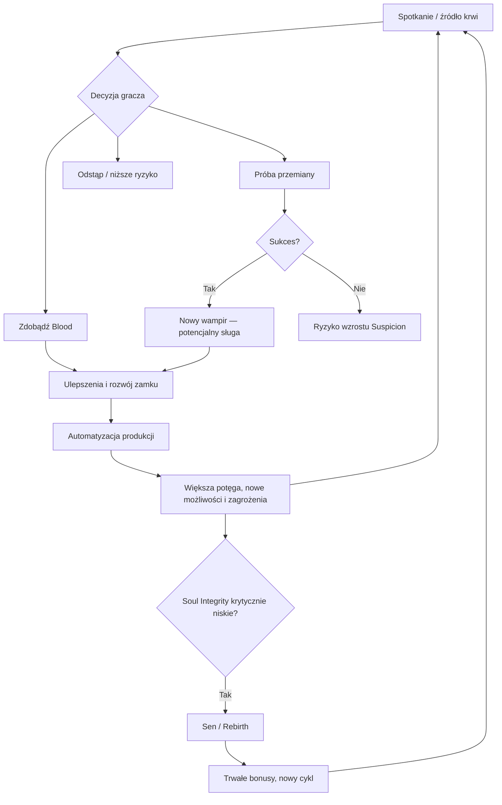

# 🦇 MOURNEVEIL: THE ETERNAL REIGN
## Game Design Document — v0.2 (wewnętrzny)

> **Blood remembers what time forgets.**  
> **Status:** dokument roboczy | **Silnik:** Unity 6 / C# | **Zespół:** dwoje twórców | **Platforma docelowa:** PC  
> ⚠️ **SPOILERY:** ten dokument zawiera prawdę o Rowanie i kuzynie Luciena. **Nie publikować go w publicznym repozytorium ani w README.**

## Jak czytać ten dokument

- **[USTALONE]** — wspólne założenie przedstawione przez twórców; można je dalej ulepszać.
- **[PROPOZYCJA]** — sugestia projektowa do omówienia i przetestowania.
- **[DO DECYZJI]** — kwestia, której jeszcze nie rozstrzygnięto.
- **[DZIAŁA W PROTOTYPIE]** — funkcja zgłoszona jako działająca w dotychczasowym Unity.

---

# 1. Wizja gry

### High concept

**[USTALONE]** *Mourneveil* to gotycki incremental-horror z elementami zarządzania zasobami, rozwoju wampirzego rodu, wyborów moralnych i narracji. Gracz wciela się w **Luciena Mourneveila**, ostatniego ocalałego dziedzica rodu. Budzi się po długim śnie w rodzinnej krypcie, bez wspomnień i wygłodzony. Jego przyjaciel **Rowan** pomaga mu odzyskać siły i tłumaczy, że łowcy zniszczyli jego rodzinę. Lucien postanawia odbudować dynastię.

Rozwój odbywa się poprzez zdobywanie krwi, podejmowanie ryzykownych decyzji podczas polowań, pozyskiwanie sług i ulepszanie zamku. **Kosztem ekspansji może być człowieczeństwo Luciena, integralność jego duszy oraz bezpieczeństwo całego rodu.**

### Doświadczenie gracza

1. **Satysfakcja progresji** — wzrost wydajności, nowe systemy, automatyzacja i przemyślany rebirth.
2. **Niepokój** — horror narasta wraz z rozwojem, głodem, podejrzeniami i odkrywaniem sekretów.
3. **Sprawczość** — pozyskanie krwi i budowa dynastii nie muszą wymagać zabijania ludzi.
4. **Emocjonalna historia** — przyjaźń Luciena i Rowana ma znaczenie mechaniczne oraz fabularne.

**[PROPOZYCJA]** Docelowy gatunkowy balans: *incremental/management* jako główny loop + horror fabularny i krótkie interaktywne wydarzenia, zamiast długich sekwencji akcji 3D.

### Zakres i priorytety

**[USTALONE]** Pierwsza wersja to **mała, grywalna produkcja 2D**, budowana przez dwoje ludzi. Nie próbujemy implementować wszystkich systemów jednocześnie.

**[PROPOZYCJA]** Pierwszy większy vertical slice powinien obejmować: prolog → pierwsze polowania w parku → prostą ekonomię krwi → jedną decyzję z konsekwencjami → jednego sługę → krótkie zakończenie demonstracyjne.

---

# 2. Świat i zasady lore

## 2.1 Ród Mourneveilów

**[USTALONE]** Rodzina Mourneveilów, wbrew stereotypowi, **nie była rodem zabójców**. Próbowała współistnieć z ludźmi: wykorzystywała krew zwierząt, dobrowolnych dawców lub krew pozyskiwaną z placówek medycznych w ramach świata przedstawionego. Nie uznawała polowania na ludzi za normę.

**[USTALONE]** Kuzyn Luciena był wyjątkiem: sadystą, który bez zgody przemieniał ludzi, szczególnie tych, u których wyczuwał podatność na wpływ. Robił to, by obserwować ich cierpienie, a nie budować stabilny ród. Pozostali Mourneveilowie potępiali jego czyny.

**[DO DECYZJI]** Dlaczego rodzina nie potrafiła go skutecznie zatrzymać? Czy został wygnany, próbował ukrywać swoje czyny, był objęty ochroną polityczną, czy działał z pomocą zewnętrznych sojuszników?

## 2.2 Przemiana i dusza

**[USTALONE]** Wampir może wyczuwać u człowieka strach i siłę woli. Przy próbie przemiany przekazuje mu **fragment własnej duszy**. Większa odporność psychiczna oznacza trudniejszą przemianę, ale nowo powstały wampir ma własne umiejętności, charakter i możliwość podejmowania decyzji.

**[USTALONE]** Fragment duszy może wpływać na pewne skłonności i cechy nowego wampira, lecz **nie determinuje jego moralności ani nie daje absolutnej kontroli nad nim**. Rowan, przemieniony przez kuzyna, odczuwa niechciane impulsy kojarzące mu się ze sprawcą; nie musi ich realizować.

**[PROPOZYCJA]** Rozdzielić *przemianę* od *lojalności*: powstanie wampira nie oznacza automatycznie, że będzie wiernym sługą. Rekrutacja może wymagać zgody, reputacji, negocjacji lub oddzielnego testu lojalności.

**[DO DECYZJI]** Czy krew zwierzęca i szpitalna ma inne właściwości w mechanice? Czy duszę da się odzyskać wyłącznie snem? Jak dokładnie Rowan potrafił powstrzymać wpływ kuzyna?

## 2.3 Łowcy

**[USTALONE]** Istnieją ludzie polujący na wampiry, a ujawnienie ich istnienia zwiększa ryzyko represji i ataków. Rowan współpracował z łowcami, początkowo sądząc, że wszyscy Mourneveilowie są podobni do jego oprawcy.

**[DO DECYZJI]** Organizacja łowców: struktura, motywy, metody, stopień wiedzy o wampirach oraz powód, dla którego nie odróżniono sadystycznego kuzyna od reszty rodu.

---

# 3. Postacie (wersja wewnętrzna)

## 3.1 Lucien Mourneveil — protagonista

**[USTALONE]** Wygląda na około 30 lat, jest wysoki (koncepcyjnie ok. 190 cm), bardzo szczupły i wycieńczony po śnie; ostre rysy, zapadnięte policzki, długie ciemne włosy, zaniedbany zarost. Zaczyna opowieść bez wspomnień i z silnym głodem. Jego wygląd w trakcie gry reaguje na **Humanity** i **Soul Integrity**.

**Motywacja jawna:** przetrwanie, odzyskanie pamięci, odbudowa rodu.  
**Konflikt:** czy odtworzy pokojowe wartości Mourneveilów, czy sam stanie się potworem?  
**[DO DECYZJI]** Przyczyna amnezji i szczegóły uśpienia; relacja z kuzynem przed katastrofą.

## 3.2 Rowan Vale — przyjaciel i ukryty zdrajca

**[USTALONE]** Wygląda na 18–20 lat, ma ok. 165 cm, miedziano-rude włosy, miękkie rysy, drobną sylwetkę; sprawia wrażenie nieszkodliwego i wrażliwego. **Uwaga:** nazwisko *Vale* i pisownia *Rowan* są robocze; w notatkach pojawia się również *Rowen*.

**Historia [USTALONE]:**

1. Był człowiekiem opiekującym się ciężko chorym ojcem; dużo pracował.
2. W drodze z pracy został zaatakowany i przemieniony wbrew woli przez sadystycznego kuzyna Luciena.
3. Po przemianie, idąc po leki dla ojca, stracił kontrolę nad wampirzym głodem i zaatakował przypadkowego człowieka.
4. Nie odebrał telefonów od ojca; po powrocie zastał go martwego po zawale. Jest przekonany, że przez swoją nieobecność mógł nie zapobiec tragedii — **to przekonanie Rowana, nie potwierdzony fakt medyczny**.
5. Obwiniał wampiry i nawiązał współpracę z łowcami.
6. Zbliżył się do Luciena, początkowo jako informator, lecz z czasem naprawdę go polubił.
7. Odkrył, że za jego tragedię odpowiadał kuzyn, nie cały ród, ale było już za późno, by zatrzymać atak na Mourneveilów.
8. Uratował Luciena i ukrył go w krypcie, by ludzie uznali go za martwego; zostawił butelki z krwią na przebudzenie.
9. W prologu opowiada Lucienowi o wymordowaniu rodziny, lecz ukrywa własną rolę w wydarzeniach i swoją przeszłość.

**Wewnętrzny konflikt:** lojalność wobec łowców kontra realna przyjaźń z Lucienem; poczucie winy; lęk, że fragment duszy kuzyna odbiera mu własną tożsamość.

**[PROPOZYCJA]** Rowan może przeżyć kryzys po odkryciu źródła własnych impulsów, lecz fabuła powinna jasno pokazać, że jego wybory pozostają jego. Nie traktować samobójstwa jako mechanicznej „metody oczyszczenia” ani koniecznej drogi do odkupienia.

## 3.3 Kuzyn Luciena — antagonista / finałowy boss

**[USTALONE]** Sadysta przemieniający ludzi dla własnej satysfakcji. To on przemienił Rowana. **[PROPOZYCJA zaakceptowana do rozważenia]** Na końcu okazuje się, że kuzyn żyje i staje się bossem.

**[DO DECYZJI]** Imię, wygląd, sposób przetrwania, cel po upadku dynastii oraz czy aktywnie manipulował łowcami. **[PROPOZYCJA]** Stworzył sieć wampirów połączonych fragmentami jego duszy.

---

# 4. Chronologia fabularna — spoilerowa

| Faza | Wydarzenie | Wiedza gracza na tym etapie |
|---|---|---|
| Przed akcją | Kuzyn prześladuje i przemienia ludzi | Nieznana |
| Przed akcją | Rowan zostaje przemieniony, a jego ojciec umiera | Nieznana |
| Przed akcją | Rowan dołącza do łowców i infiltruje ród | Nieznana |
| Przed akcją | Rowan zaprzyjaźnia się z Lucienem | Początkowo tylko „dawny przyjaciel” |
| Przed akcją | Łowcy atakują, giną Mourneveilowie; Rowan ratuje Luciena | Rowan mówi tylko o ataku |
| Prolog | Lucien budzi się w krypcie, pije pozostawioną krew | Fragmenty amnezji i głód |
| Rozdział II | Pierwsze polowania w parku | Podstawowe zasady krwi i zagrożenia |
| Dalsza gra | Rozwój dynastii i konfrontacja z łowcami | Coraz więcej sprzecznych wskazówek |
| Przed finałem | Ujawnienie prawdy o Rowanie i kuzynie | Pełna lub niemal pełna historia |
| Finał | Powrót kuzyna i konsekwencje wyborów | Wybór drogi dynastii |

**[DO DECYZJI]** Dokładna skala czasu: historia Rowana ma telefon i aptekę; gra najpewniej rozgrywa się we współczesności z gotycką estetyką. Trzeba dopracować, jak długo Lucien spał i czy Rowan pozostał przy nim przez ten czas.

---

# 5. Sceny i przebieg rozgrywki

## 5.1 `Crypt_Intro` — Prolog: The Awakening

**[USTALONE]** Lucien budzi się bez pamięci. Obok niego znajduje się pięć butelek krwi zostawionych przez Rowana. Każde kliknięcie wypija porcję i ujawnia fragment wspomnienia. Po ostatniej butelce zaczyna się sekwencja głodu i trzy gwałtowne uderzenia w drzwi. Pojawia się Rowan, opowiada okrojoną historię upadku rodu i wskazuje konieczność zdobycia krwi. Następnie przejście do polowania w parku.

**Stan implementacji według zgłoszeń twórców:**

- **[DZIAŁA W PROTOTYPIE]** Prolog v0.2: przebudzenie/fade, picie butelek, tekstowe wspomnienia, czerwone efekty, głód, odgłosy, pukanie, dialog z efektem pisania.
- **[W TRAKCIE INTEGRACJI / NIEPOTWIERDZONE]** Interaktywne sprite’y pięciu butelek i v0.3.
- **[DO DECYZJI]** Treść i obrazy konkretnych pięciu wspomnień — twórcy chcą ustalić je wspólnie.

**Zasada projektowa:** prologowe butelki są **skończonym zasobem narracyjnym**, nie walutą wydawaną na ulepszenia. Zapobiega to konfliktowi między ekonomią a obowiązkowym wydarzeniem fabularnym.

## 5.2 `Park` — Chapter II: The First Hunt

**[USTALONE]** Lucien spotyka ludzi o zróżnicowanych cechach (w tym siła woli). Może zabrać niewielką ilość krwi (ofiara traci przytomność), wymazać wspomnienie, odebrać całą krew (ofiara umiera) lub spróbować przemienić człowieka, wydając punkty duszy. Ryzyko wykrycia, Humanity i potencjał przyszłego sługi mają zmieniać opłacalność opcji.

**[PROPOZYCJA]** Mechanika jednego encountera:

1. Losowany człowiek: portret + 3–5 statystyk + krótki kontekst.
2. Wybór: pobierz mało krwi / wymaż pamięć (po lub w ramach pobrania) / zabij / przemiana / odstąp.
3. System oblicza zasób, wpływ na Humanity/Suspicion, ewentualnie Soul Integrity.
4. Krótki rezultat: sukces, porażka, alarm, nowy sługa.
5. Kolejna osoba albo powrót do zamku.

**[DO DECYZJI]** Czy gracz kontroluje przemieszczanie się po parku, czy park jest ekranem spotkań? Jak działa wymazanie pamięci: koszt, cooldown, szansa powodzenia? Czy próbę przemiany można podejmować bez zgody, i jak wpływa to na Humanity?

## 5.3 Odbudowa zamku

**[USTALONE — kierunek]** Odbudowujemy dynastię i automatyzujemy pozyskiwanie krwi przez sługi-wampiry.

**[PROPOZYCJA]** Kolejne pokoje: Krypta (sen i rebirth), Sala Tronowa (zarządzanie rodem), Biblioteka (badania), Alchemia (ulepszenia), Izba Sług (automatyzacja), Zakazana Komnata (wysokie ryzyko fabularne).

---

# 6. Core gameplay loop



**Ważne:** historia i gameplay mają się przecinać; decyzje gracza dotyczące polowań powinny zmieniać reakcje Rowana, wygląd Luciena i ryzyko konfliktu z łowcami.

---

# 7. Zasoby, statystyki i konsekwencje

| System | Rola | Zysk / strata | Stan |
|---|---|---|---|
| **Blood** | Główna waluta i podstawa produkcji | Polowania, dawcy, źródła alternatywne; wydatki na rozbudowę | **Ustalone; prosty prototyp działa** |
| **Humanity** | Zachowanie empatii, kontrola popędów, wygląd | Okrucieństwo obniża; etyczne wybory mogą podnosić | **Ustalone koncepcyjnie** |
| **Soul Integrity** | Dusza jako zasób przemiany i zmęczenia | Przemiana kosztuje duszę; sen odnawia ją | **Ustalone koncepcyjnie** |
| **Suspicion** | Wiedza ludzi o wampirach / aktywność łowców | Nieudane przemiany, zabójstwa, świadkowie zwiększają | **Ustalone koncepcyjnie** |
| **Willpower (NPC)** | Odporność na przemianę | Wpływa na szanse; nie określa innych zdolności | **Ustalone / zasada do balansu** |
| **Awakening** | Wczesny wskaźnik grozy zamku z prototypu | Nie ustalono roli w nowej pełnej mechanice | **Do decyzji: zachować czy zastąpić?** |
| **Rowan Trust** | Ukryte zaufanie / nastawienie przyjaciela | Wybory Luciena, sytuacje fabularne | **Propozycja** |
| **Hunger** | Potrzeba krwi i ryzyko utraty kontroli | Zużycie krwi, odpoczynek, polowanie | **Propozycja późniejsza** |

### Rozróżnienie dwóch przemian wyglądu

- **Humanity ↓**: bardziej drapieżne zachowanie, oczy i mimika, stopniowa przemiana w potworną postać.
- **Soul Integrity ↓**: osłabienie, postarzenie i wyniszczenie, nawet jeżeli Lucien zachowuje empatię.

**[PROPOZYCJA]** UI zawsze pokazuje Blood; Humanity, Soul Integrity i Suspicion odkrywamy stopniowo, kiedy gracz pozna ich znaczenie. Przy pierwszym kontakcie nie zasypujemy go czterema nowymi paskami.

---

# 8. Ludzie, polowanie i przemiana

## 8.1 Statystyki spotkanych NPC

**[PROPOZYCJA]** Każda postać ma niezależne wartości: `willpower`, `strength`, `intelligence`, `stealth`, `loyaltyPotential`, `soulAffinity`, `bloodYield`, `witnessRisk`. To **cechy fikcyjnego systemu gry**, nie diagnostyczna ocena wartości czy zdrowia psychicznego człowieka.

## 8.2 Próba przemiany — model do prototypowania

**[PROPOZYCJA, NIE USTALONY BALANS]** Dla przykładowego modelu przyjmujemy skalę 0–100 i zależność:

```text
chance = clamp(85 - 0.65 * willpower + 0.4 * (soulInvested - 20), 5, 95)
```

Model **tylko do przetestowania odczuć**. Prawdopodobieństwa, minimalne koszty i skutki niepowodzenia trzeba wyznaczyć na podstawie playtestów. Unikać sytuacji, w której gracz może nieodwracalnie stracić całą duszę i zablokować kampanię.

### Konsekwencje decyzji — szkic

| Akcja | Natychmiast | Możliwe koszty |
|---|---|---|
| Niewielkie pobranie | +mało Blood | utrata przytomności, niskie/średnie ryzyko świadków |
| Wymazanie pamięci | niższe ryzyko zgłoszenia | koszt mocy/cooldown/ryzyko porażki |
| Zabicie | +dużo Blood | −Humanity, +Suspicion, wzrost presji łowców |
| Przemiana | szansa na nowego wampira | −Soul Integrity, niepowodzenie, +Suspicion, kwestia lojalności |
| Odstąpienie | brak krwi | zachowanie Humanity, ograniczenie ryzyka |

**[PROPOZYCJA]** Istotny jest wybór bez zabijania. Alternatywy (dawcy, krew zwierzęca, handel/zaopatrzenie) powinny być realnie grywalne, nie jedynie symboliczne.

---

# 9. Automatyzacja, słudzy, rebirth

## 9.1 Słudzy

**[USTALONE]** Pozyskani wampirzy słudzy mają różne statystyki i automatyzują pozyskiwanie zasobów.

**[PROPOZYCJA]** Każdy ma rolę (łowca, badacz, zwiadowca, negocjator, opiekun dostaw), efektywność, zaufanie, koszt utrzymania i ryzyko wykrycia. Lojalność powinna mieć własne zasady, a nie zależeć wyłącznie od powodzenia przemiany.

## 9.2 Rebirth = wielowiekowy sen

**[USTALONE]** Każda przemiana odbiera fragment duszy Luciena. Gdy jest wyczerpany, wraca do krypty i zapada w sen — fabularnie uzasadniony prestige/rebirth.

**[PROPOZYCJA]** Cykl:

1. Rozwój dynastii, rekrutacja, wzrost produkcji.
2. Zmniejszenie Soul Integrity w zamian za ekspansję.
3. Decyzja o śnie (dobrowolna po progu lub wymuszona przy krytycznym stanie — do ustalenia).
4. Reset **części** systemów + trwały postęp rodu (np. relikwie, odkryte sekrety, miejsce na wiecznych sług).
5. Przebudzenie z nowymi możliwościami i kolejnymi fragmentami historii.

**[DO DECYZJI]** Co zachowuje się po śnie? Co robi Rowan podczas cykli? Co dzieje się z wybranymi sługami? Czy łowcy i Suspicion resetują się częściowo? Jak długo trwa jedna „epoka” fabularnie?

**[PROPOZYCJA]** *Eternal Retainers* — niewielka liczba wiernych sług może przetrwać sen, aby prestige dawał trwałe poczucie rozwoju, a nie czystą utratę inwestycji.

---

# 10. Narracja i wybory

## 10.1 Zasada ujawniania prawdy

Nie ujawniać wcześnie: kto przemienił Rowana, jego współpracy z łowcami, jego udziału w zagładzie rodu ani losu kuzyna. Sugerować to subtelnie przez uniki w dialogach, niezgodności relacji, dokumenty i zachowanie Rowana.

**[PROPOZYCJA]** Sekrety dzielą się na trzy warstwy: informacje o łowcach → prawda o przemianie Rowana → pełna prawda o ataku i kuzynie.

## 10.2 Zakończenia (niezatwierdzone)

- **Odbudowa dziedzictwa:** Lucien utrzymuje Humanity i honoruje pokojowe wartości rodu.
- **Wampirza tyrania:** Lucien zyskuje potęgę, lecz staje się podobny do kuzyna.
- **Rozliczenie z przeszłością:** więź z Rowanem i decyzje wobec kuzyna zmieniają finał.

**[DO DECYZJI]** Liczba zakończeń, warunki zakończenia, forma walki z bossem (ekonomia/wybory/minigra zamiast rozbudowanego combat systemu).

---

# 11. Styl wizualny i audio

## 11.1 Art direction

**[USTALONE]** Wybrany kierunek głównego interfejsu: bogaty, gotycki, arystokratyczny. Czerń, burgund, szkarłat, metaliczne filigrany, czerwony witraż, świece, zasłony, róże, kamień i ozdobna trumna.

**[USTALONE / ELEMENT DO UJEDNOLICENIA]** Portrety i sprite’y Luciena/Rowana opracowywane są w estetyce stylizowanego pixel artu. **[DO DECYZJI]** Czy całe środowisko ma być pixel artem, czy tło pozostanie ilustracyjne, a postacie bardziej pikselowe? Należy unikać niezamierzonej niespójności rozdzielczości.

### Postacie — założenia wizualne

| Lucien | Rowan |
|---|---|
| Pozornie ~30 lat, wysoki, wycieńczony | Pozornie 18–20 lat, ~165 cm |
| Ostre rysy, długie ciemne włosy, zarost | Miękkie rysy, rude włosy, młodzieńcza twarz |
| Zniszczony strój arystokratyczny | Skromniejszy płaszcz, prosty ubiór |
| Groźna aparycja, możliwość empatycznej ścieżki | Niewinna aparycja, skrywana przeszłość |

## 11.2 Horror i dostępność

**[USTALONE]** Głód po butelkach, trzy uderzenia w drzwi, narastające napięcie, zaskoczenie. **[PROPOZYCJA]** Dodać ustawienia: ograniczenie błysków/drgań, oddzielna głośność efektów grozy, możliwość ograniczenia jumpscare’ów i regulację szybkości tekstu.

**Kierunek audio:** cisza przed hukiem, bicie serca, ciężki oddech, szepty, wosk i kroki, stonowany ambient zamiast ciągłej muzyki.

---

# 12. Projekt techniczny (Unity / C#)

## 12.1 Stan i organizacja

**[DZIAŁA W PROTOTYPIE]** Gra ma prostą scenę `Crypt` z Blood, produkcją pasywną, ulepszeniami i zapisem oraz scenę `Crypt_Intro` z fabularnymi sekwencjami v0.2. Błędy skryptu `MourneveilCryptLayoutBuilder` były osobnym problemem narzędzia edytora; **nie opierać nowej logiki na tym skrypcie**.

**[PROPOZYCJA]** Oddzielać:

- `GameState` — trwałe dane rozgrywki.
- `BloodEconomy` — bilans zasobów i produkcja.
- `HuntingSystem` — spotkania i wybory.
- `HumanitySystem`, `SoulSystem`, `SuspicionSystem` — niezależne reguły.
- `ServantSystem` — dane i produkcja sług.
- `PrestigeSystem` — sen, resety i trwałe bonusy.
- `StoryDirector` — warunki odblokowania fabuły, bez mieszania ze stanem UI.
- `SaveSystem` — wersjonowanie zapisu i wczytywanie.
- `UI` — prezentacja stanu i interakcje.

**[PROPOZYCJA]** `ScriptableObject` na definicje upgrade’ów, typy encounterów, NPC, eventy i rozmowy. Zapis JSON powinien przechowywać **ID i stan**, nie referencje bezpośrednio do assetów.

## 12.2 Przykładowe dane NPC

```csharp
[System.Serializable]
public class HumanEncounterState
{
    public string encounterId;
    public int willpower;
    public int strength;
    public int intelligence;
    public int stealth;
    public int bloodYield;
    public int witnessRisk;
}
```

To **szkic struktury**, a nie kod produkcyjny ani gotowy system Unity.

## 12.3 Organizacja projektu (propozycja)

```text
Assets/
├── Scenes/
│   ├── Crypt_Intro.unity
│   ├── Park.unity
│   └── Crypt.unity
├── Scripts/
│   ├── Core/
│   ├── Prologue/
│   ├── Hunting/
│   ├── Characters/
│   ├── Economy/
│   ├── Prestige/
│   ├── Story/
│   └── UI/
├── ScriptableObjects/
├── Art/
│   ├── Backgrounds/
│   ├── Characters/
│   └── UI/
├── Audio/
└── Prefabs/
```

**[USTALONE]** Repozytorium git jest publiczne. Na GitHub trafiają kod i publiczne materiały produkcyjne, **nie pełna spoilerowa biblia fabuły**. Prawa do assetów oraz zgody na ich publikację wymagają uwagi.

---

# 13. MVP, roadmapa i testy

## Potwierdzone dotychczas

- [x] Wybór koncepcji, rodu i kierunku wizualnego UI.
- [x] Podstawowy prototyp Crypt: zasób, produkcja, ulepszenia, zapis.
- [x] Prolog v0.2: butelki jako interakcja, wspomnienia tekstowe, głód, pukania, dialog i efekty.
- [ ] Potwierdzenie działania nowego wizualnego układu pięciu klikanych butelek v0.3.

## Kolejny milestone: **Park v0.1 — Moral Choice Prototype**

**Minimalny zakres:**

- [ ] Jeden ekran parku i prosty UI spotkania.
- [ ] 3 typy ludzi z różnymi statystykami (dane przykładowe).
- [ ] Dwie decyzje na start: pobranie niewielkiej ilości krwi / odstąpienie.
- [ ] `Suspicion` rośnie w zależności od zachowania; wskazanie skutków w UI.
- [ ] `Humanity` ma co najmniej jedną widoczną konsekwencję.
- [ ] Zapis/wczytanie nowego stanu.
- [ ] Test balansu: czy gracz rozumie ryzyko bez instrukcji poza grą?

**Następny milestone:** przemiana jednego NPC w sługę, koszt Soul Integrity, wyliczenie szansy, porażka i pierwszy generator pasywny.

**Dopiero potem:** rebirth, rozbudowane zachowania łowców, wiele komnat, boss, alternatywne zakończenia.

### Acceptance criteria — pierwszy park

1. Wybory mają jasno zapowiedziane koszty i konsekwencje.
2. Nie da się zablokować gry jednym nieudanym spotkaniem.
3. `Suspicion` może wzrosnąć i ma czytelny efekt.
4. `Humanity` nie jest „punktacją dobra/zła”, tylko wpływa na kontrolę nad głodem, relacje i wygląd.
5. Stan zapisuje się i odtwarza poprawnie.

---

# 14. Ryzyka i przeciwdziałanie

| Ryzyko | Co robimy |
|---|---|
| Zbyt wielki zakres | Każdy milestone ma jedną nową zasadę i mierzalny test |
| Ekonomia bez wyborów | Każdy sposób zdobywania Blood ma zalety i konsekwencje |
| Prestige odbiera wszystko | Zachowanie części postępu i czytelnych trwałych korzyści |
| Wątki zdrady zbyt wcześnie oczywiste | Wskazówki rozłożone w czasie, bez dosłownych spoilerów |
| Rozbieżny styl grafik | Jedna paleta, zasady rozdzielczości i dokument stylistyczny |
| Przeciążone UI | Statystyki ujawniane stopniowo; możliwość obejrzenia szczegółów |
| Konflikty Git/Unity | Osobne branche, małe PR, wspólne zasady pracy na scenach |
| Publiczne spoilery | GDD przechowywać w prywatnym vault/repo, README bez ujawnienia twistu |

---

# 15. Backlog decyzji do rozmowy

| Pytanie | Priorytet | Status |
|---|---|---|
| Jak brzmi imię kuzyna i na czym polega jego plan? | Średni | Do decyzji |
| Dlaczego rodzina nie zatrzymała kuzyna? | Wysoki fabularnie | Do decyzji |
| Jak długo spał Lucien i skąd wzięła się amnezja? | Wysoki fabularnie | Do decyzji |
| Jakie są dokładnie 5 wspomnień w prologu? | Wysoki produkcyjnie | Do decyzji |
| Czy środowiska będą pixel art, czy malarskie 2D? | Wysoki produkcyjnie | Do decyzji |
| Czy park jest point-and-click czy panelem spotkań? | Wysoki produkcyjnie | Do decyzji |
| Czy przemiana i rekrutacja są dwiema decyzjami? | Wysoki mechanicznie | Propozycja |
| Co kosztuje wymazanie pamięci? | Średni | Do decyzji |
| Co zachowujemy po rebirth i co z Rowanem podczas snu? | Wysoki mechanicznie | Do decyzji |
| Jak zachowuje się system Awakening z pierwszego prototypu? | Średni | Do decyzji |
| Liczba zakończeń i rola Humanity / Rowan Trust | Późniejszy | Do decyzji |
| Czy imię „Rowan” i nazwisko „Vale” są ostateczne? | Niski | Do potwierdzenia |

---

# 16. Dziennik zmian

**v0.2 — 2026-11-18**
- Wprowadzono prawdziwą historię rodu, Rowana i sadystycznego kuzyna.
- Zdefiniowano systemy Humanity, Soul Integrity, Suspicion i Willpower.
- Połączono przemiany sług z rebirth przez koszt duszy.
- Dodano historię etycznego zdobywania krwi i konsekwencji wyborów.
- Rozdzielono ustalenia od propozycji; ujęto zakres Park MVP.

**Następna aktualizacja:** po wspólnych decyzjach twórców dotyczących parku, pięciu wspomnień i reguł przemiany.
